<div align="center">


<br/>



<br/>


</div>

<br/>


```bash
$ cat /home/syedmuhammadumar-eng/bio.txt

  name        →  Syed Muhammad Umar
  role        →  Aspiring Full-Stack Developer & AI Engineer
  location    →  [City, Country] 🌍
  education   →  [Your degree / university / self-taught]
  languages   →  Java · Python · SQL · [more]
  interests   →  Backend systems · Machine Learning · Robotics
  hobbies     →  [Gaming · Music · Sci-fi · Gadgets]
  motto       →  "Learn it. Build it. Break it. Ship it."
```


> **`[ ANALYSIS COMPLETE ]`**
>
> **Syed Muhammad Umar** is a driven developer building a strong foundation in **Java full-stack development with Spring Boot**, while sharpening core engineering skills like **data structures & algorithms** and **system design**. Alongside the backend path, he is exploring **artificial intelligence**, including **machine learning, deep learning and data science** with **NumPy and Pandas**, and is curious about **robotics**, where software meets the physical world.
>
> His profile shows a builder's mindset: learn a concept, apply it in a project, and iterate. The goal is to grow into an engineer who can design scalable systems **and** add intelligence to them.
>
> <sub>🧠 Summary generated by AI from my profile.</sub>


<div align="center">

**☕ Java Full-Stack**


**🧠 AI / ML / Data Science**


**🤖 Robotics & Systems**


</div>

### 📡 Focus Areas

| Domain | What I'm learning |
|:--|:--|
| ☕ **Java Full Stack** | Core Java, Spring Boot, REST APIs, Spring Security, JPA/Hibernate, frontend integration |
| 🏗️ **System Design** | Scalability, load balancing, caching, databases, microservices, API design |
| 🧩 **DSA** | Arrays, linked lists, trees, graphs, DP, recursion, problem-solving patterns |
| 🤖 **AI / Machine Learning** | Supervised and unsupervised learning, model evaluation, feature engineering |
| 📊 **Data Science** | Data cleaning, analysis and visualization with **NumPy** and **Pandas** |
| 🧠 **Deep Learning** | Neural networks, CNNs, RNNs, transformers, training and tuning |
| 🦾 **Robotics** | Sensors, actuators, microcontrollers, control systems, computer vision |

```text
Java & Spring Boot    ████████░░░░░░░░░░░░  40%
DSA                   ██████░░░░░░░░░░░░░░  30%
System Design         ████░░░░░░░░░░░░░░░░  20%
NumPy & Pandas        ██████░░░░░░░░░░░░░░  30%
Machine Learning      ████░░░░░░░░░░░░░░░░  20%
Deep Learning         ██░░░░░░░░░░░░░░░░░░  10%
Robotics              ██░░░░░░░░░░░░░░░░░░  10%
```


- [ ] 🚀 Build a complete **Spring Boot full-stack app** with authentication, database and deployment
- [ ] 🧩 Solve **[300+] DSA problems** and learn the major patterns
- [ ] 🏗️ Design and document **5 real-world systems** (URL shortener, chat app, feed, etc.)
- [ ] 📊 Complete **3 data analysis projects** using NumPy and Pandas
- [ ] 🤖 Train and deploy a **machine learning model** as a working API
- [ ] 🧠 Build a **deep learning project** (image classification or NLP)
- [ ] 🦾 Create a **robotics project** with sensors and a microcontroller
- [ ] 🌐 Contribute to **open source**


<table>
  <tr>
    <td width="50%" valign="top">
      <h3>☕ [Spring Boot Project]</h3>
      <p>[One line: what it does, e.g. REST API for a task manager with JWT auth.]</p>
      <p><code>Java</code> <code>Spring Boot</code> <code>MySQL</code></p>
      <a href="https://github.com/syedmuhammadumar-eng/REPO_ONE">⟶ View Repo</a>
    </td>
    <td width="50%" valign="top">
      <h3>📊 [Data Science Project]</h3>
      <p>[One line: dataset analyzed and insights found.]</p>
      <p><code>Python</code> <code>Pandas</code> <code>NumPy</code></p>
      <a href="https://github.com/syedmuhammadumar-eng/REPO_TWO">⟶ View Repo</a>
    </td>
  </tr>
  <tr>
    <td width="50%" valign="top">
      <h3>🧠 [ML / Deep Learning Project]</h3>
      <p>[One line: what the model predicts or classifies.]</p>
      <p><code>Python</code> <code>TensorFlow</code> <code>scikit-learn</code></p>
      <a href="https://github.com/syedmuhammadumar-eng/REPO_THREE">⟶ View Repo</a>
    </td>
    <td width="50%" valign="top">
      <h3>🦾 [Robotics Project]</h3>
      <p>[One line: what the robot does.]</p>
      <p><code>C++</code> <code>Arduino</code> <code>Sensors</code></p>
      <a href="https://github.com/syedmuhammadumar-eng/REPO_FOUR">⟶ View Repo</a>
    </td>
  </tr>
</table>


<div align="center">

<a href="https://github.com/syedmuhammadumar-eng/REPO_ONE"></a>
<a href="https://github.com/syedmuhammadumar-eng/REPO_TWO"></a>

<a href="https://github.com/syedmuhammadumar-eng/REPO_THREE"></a>
<a href="https://github.com/syedmuhammadumar-eng/REPO_FOUR"></a>

</div>


```text
PHASE 1  ▸  Java + DSA fundamentals, Git, SQL
PHASE 2  ▸  Spring Boot, REST APIs, security, first full-stack project
PHASE 3  ▸  System design, microservices, Docker, cloud deployment
PHASE 4  ▸  Python, NumPy, Pandas, data science projects
PHASE 5  ▸  Machine learning, deep learning, model deployment
PHASE 6  ▸  Robotics, sensors, computer vision, final capstone
```


| 🔥 Working on | 📚 Learning | 🎯 Next target |
|:---:|:---:|:---:|
| [Project name] | [Spring Boot / DSA] | [Goal for this month] |


- ⚡ [Something unique about you]
- 🎧 I code best while listening to [music genre]
- 🌌 Favorite sci-fi: [movie / anime / game]


<div align="center">

<a href="https://linkedin.com/in/YOUR_LINKEDIN"></a>
<a href="mailto:your@email.com"></a>
<a href="https://your-portfolio.com"></a>
<a href="https://x.com/YOUR_HANDLE"></a>
<a href="https://instagram.com/YOUR_HANDLE"></a>
<a href="https://youtube.com/@YOUR_HANDLE"></a>
<a href="https://leetcode.com/YOUR_HANDLE"></a>
<a href="https://kaggle.com/YOUR_HANDLE"></a>

<br/><br/>


</div>
